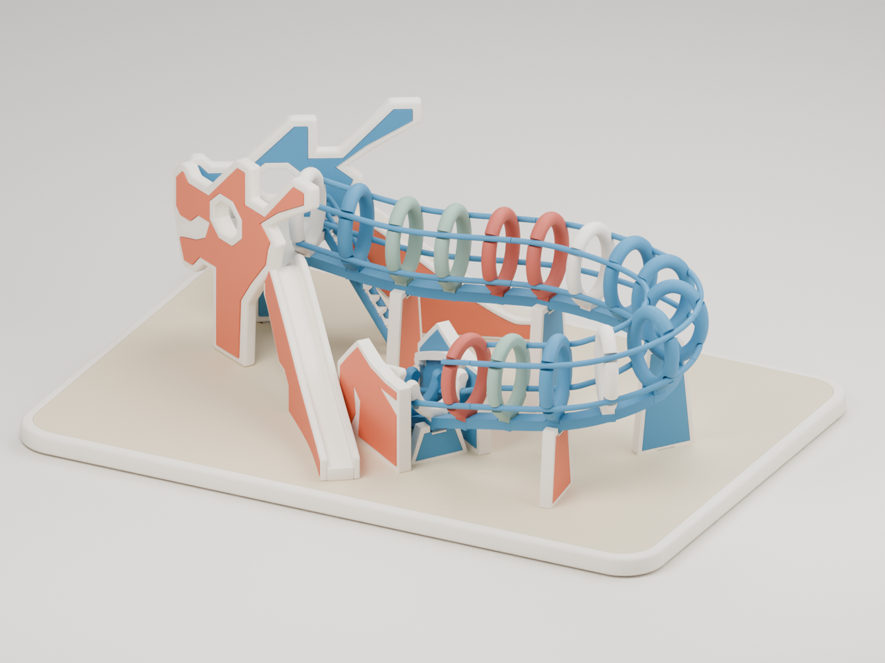

# Toa Payoh Dragon

A small, soft-edged interpretation of Singapore’s Toa Payoh Dragon Playground, made with puffy hoops, a colourful winding body and chunky slide supports.

[Project website](https://echoz.github.io/ToaPayohDragon/) · [Download the v03 STL kit](exports/dragon-pla-kit-v03.zip) · [Start with the fit samples](exports/dragon-pla-kit-v03/FIT-TESTS.md)

## Print status

**v03 is a fit-test candidate.** Digital mesh, clearance, insertion-path and offline slicing checks passed. Physical printing, fit and support removal have not been tested. Print the representative joints before the whole model, and use matching v03 parts.

Prepared for a **Bambu Lab X1 Carbon with a 0.4 mm nozzle and PLA**. Six colours print separately; no AMS is required. The kit includes **94 model parts, 29 fit samples and 9 optional assembly cradles** across 19 layouts. Some pieces require supports. Use the supplied orientations at 100% scale.

- [Print settings and assembly guide](exports/dragon-pla-kit-v03/README.md)
- [Numbered plate and assembly maps](exports/dragon-pla-kit-v03/assembly-map.html) — open the downloaded HTML locally
- [Tolerance checks and their limits](exports/dragon-pla-kit-v03/TOLERANCE-REVIEW.md)
- [Cantilever and support guidance](exports/dragon-pla-kit-v03/CANTILEVER-REVIEW.md)
- [Editable printable assembly](model/blender/dragon-print-kit-v03.blend)

The kit ZIP is the existing validated artifact; publication does not regenerate its geometry. SHA-256: `614826200cf5f60f3b15884abf88248671c4207a51d37d3097c312009f65d972`.

The original design, meshes, documentation and renders are available under
**CC BY-NC-SA 4.0** for noncommercial printing, sharing and remixes. Give credit,
indicate changes and follow its ShareAlike terms. Read the
[license scope and attribution](LICENSE-SCOPE.md) for coverage and exclusions.
The unchanged v03 ZIP predates this notice; save the accompanying
[license](LICENSE.txt) and [scope notice](LICENSE-SCOPE.md) with your download.

## Shape and source

The model captures the playground’s gist rather than reproducing it to survey accuracy. The printable version has 15 closed puffy hoops and three open tail rungs, a photo-informed head and slides, and a split display base. The playground length is approximately 230 mm, excluding the base.

| Area | Guide |
| --- | --- |
| Editable visual model and Blender workflow | [model/README.md](model/README.md) |
| Final-millimetre printable geometry | [model/printkit/README.md](model/printkit/README.md) |
| Build, validation and packaging | [scripts/README.md](scripts/README.md) |
| Public project website | [site/README.md](site/README.md) |

[Design direction](docs/design-direction.md) distinguishes the approved concept, the visual v06 model and the printable v03 assembly. [Reference records](references/README.md) retain photograph sources and attribution; photographs are not bundled.

## Repository contents

This public checkout contains the current source, required source meshes, editable Blender scenes, v03 kit, selected renders and its digital evidence. It omits superseded print kits, procedural drafts, duplicate render galleries, downloaded reference photos, Python environments, Blender backups and transient scratch files. The original authoring folder retains that history locally.

The retained `exports/dragon-pla-kit/work/source-v06/` directory is an input to the current print library despite its older parent name. The v03 `work/assembly/` meshes and slicing records support the existing validators and packager. Do not remove either as disposable cache. Logs may contain paths from the authoring machine; they are historical evidence rather than portable instructions.

## Verification and publication

Run `python3 scripts/check_documentation.py` and `python3 scripts/check_publication.py`. The documentation gate pins EngineeringRules 0.1.10 at `756987b0d0e4bf8245abe05611f43aab8ffc700e`; see the toolchain guide for its separate installation requirements. The publication check verifies local links, Python syntax, kit checksums and website boundaries without generating CAD.

GitHub Pages publishes only `site/` after changes land on `main`. Pull requests receive the publication check and a separate engineering review. CAD and browser checks establish different evidence; neither proves a successful physical print.
